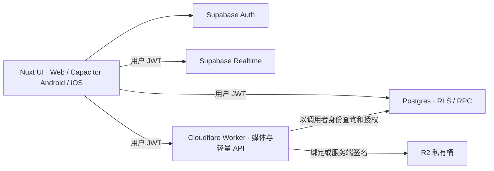

# 私密情侣空间架构

## 运行边界

复用 Nuxt 4、Vue 3、TypeScript、现有组件及 composables。Capacitor 加载本地 `.output/public`，Windows 负责日常开发和 Android，macOS CI 负责 iOS。网页可复用同一套静态产物。原项目的 Supabase Storage/Tus 传输层替换为 R2，原先为音乐服务的 Nitro 和 Pages Functions 路由随模块拆除。

| 层 | 复用与改造 |
| --- | --- |
| 界面和业务 | 首页、相册、时光、聊天、日历、清单、纪念日、安全和浪漫组件继续使用原页面。功能稳定后再做风格改版。把 `app/app.vue` 中被排除模块的初始化、订阅和导航拆出 |
| Auth 与数据 | 继续使用 Supabase Auth 的登录、续期、会话和原有业务 SQL 的有效部分。静态产物只含独立项目 URL 和可公开的 publishable/anon key。业务读写由 RLS 及带身份的 RPC 执行。按 [空库计划](DATABASE_PLAN.md) 处理账号准入和双人约束 |
| 账户管理服务 | 复用 `account-auth`、`account-security` 的服务端流程，以精简后的 Supabase Edge Functions 保留账号名映射、恢复码、管理 Auth 用户的边界。Worker 负责媒体和所需轻量 API，两处职责分开；敏感操作应校验 JWT、近期重认证和限流。service_role 只在必须管理 Auth 用户的服务端使用 |
| 实时与提醒 | 保留现有 Realtime 和本地通知思路。新通知中心组合保留活动流、聊天未读、纪念日、日历、签到及上传状态。已有已读历史主要存在本地。应用恢复前台时补拉并去重。后台普通远程通知需要独立 APNs/FCM 接入，锁屏默认只给通用提示 |
| Web 与原生 | 原生优先保留本地壳，不加载上游远程页面。OAuth/验证采用系统浏览器与受限回调，按平台做权限、键盘、安全区、返回和文件选择适配。桌面与介绍页的上游 URL 必须换成自己控制的端点后再发布 |

## 直接依赖处理

| 依赖 | 后续处理 |
| --- | --- |
| `nuxt`、`vue`、`vue-router`、`@supabase/supabase-js` | 核心保留。固定经 CI 验证的组合，核对 Supabase SDK 类型边界及 npm 安全公告 |
| `@lucide/vue`、两套 Fontsource 字体、`gsap` | 复用图标、字体、动效和减少动画逻辑，保留并验证 `scripts/patch-lucide-context.cjs` 与对应测试 |
| `@capacitor/core`、`android`、`cli`、`local-notifications`、`splash-screen`、`status-bar` | 保留并添加匹配版本的 iOS 平台。推送插件由独立的普通后台通知需求决定，来电发送器和默认来电注册路径移除 |
| `@uppy/core`、`@uppy/golden-retriever`、`tus-js-client` | 保留队列和文件持久化。以 R2 传输替换 Tus 实现，待旧数据读取策略确认后清理无引用依赖 |
| `@capacitor/geolocation`、`leaflet`、`three`、`zego-express-engine-webrtc` | 随位置、宠物、通话独占模块退出。检查生产依赖树及 `protobufjs` override 仍有哪些消费者，再决定是否可移除 |
| `typescript`、`vitest`、`happy-dom`、`@playwright/test` | 保留测试工具，补真正遍历 Vue SFC 的类型检查、本地 Supabase 集成与原生冒烟 |
| `electron`、`electron-builder`、`qrcode` | 原版桌面和发布／介绍脚本的依赖，保持独立于 APK/IPA 产物。继续追踪维护，不把其二进制纳入移动构建 |

## 私有媒体

- 对头像、封面、相册、图文回忆、聊天附件与声音胶囊共用媒体适配器。数据库保存 `media_id`、业务归属、类型、状态和变体引用。对象键在服务端生成并含 `couple_id`，原始业务表是可见性来源。Worker 验证 Supabase JWT 的签名、issuer、audience、过期时间和 subject，再用用户 JWT 调用受 RLS 约束的元数据/RPC，检查成员、资源和业务状态。CORS 只允许已确认的 Web 及原生 WebView origin；每个请求仍需授权。
- 上传先在 DB 分配幂等 ID 和 `pending` 记录。小文件使用受控上传，大视频用 R2 的 S3 签名 PUT 或分段上传。签名只允许特定键、方法和 MIME，短时有效。完成时核对 R2 HEAD、大小和类型，必要时检查内容，标记可读后才挂接到业务行。失败、取消和同一请求重试不得生成重复消息或公开孤儿文件。后台清理过期草稿与中断上传。保留 Uppy 的队列与持久化体验，`tus-js-client` 只有在完全替换 Supabase Storage Tus 后才移除。
- 下载默认使用 Worker 做授权，并支持视频/音频 `Range`、`206` 和正确 MIME。原生及浏览器媒体标签不能统一设置 Bearer header，可以用有时效且仅绑定单个媒体 ID 的播放票据。每次 Range 请求查验票据、当前成员与业务状态，票据不包含 Supabase JWT，路径不进入业务日志。对允许短期撤销窗口的资源，可签短期 R2 URL。签名在过期前可以被持有者复用。测试撤回、解绑、过期和声音胶囊访问，控制缓存、CORS、签名日志与 Referer。 [R2 签名地址](https://developers.cloudflare.com/r2/api/s3/presigned-urls/)
- 复用现有图片压缩、缩略图、原图和视频海报逻辑。限制体积和单空间占用，保留可识别的失败状态。持久缓存按用户／空间命名，退出、换号和解绑主动清理 Cache Storage、IndexedDB、localStorage 与内存中的媒体。原生避免将私密内容带入系统备份。导出由用户显式发起并在 UI 中说明内容范围，锁定内容仍走同一授权规则。

## 密钥、部署和成本

- 开发、验收、个人生产使用独立项目、桶和身份。R2 保持私有，Worker 使用 R2 binding，只有签名路径需要最小桶范围 S3 凭据。私钥、service_role、OAuth Secret、APNs/FCM 凭据和签名文件均通过服务端或 CI 密钥管理。签名和部署 workflow 只在信任的 ref 手动触发，避免公开 fork 的外部 PR 读取机密。禁止打包原作者的更新源、数据库或下载路径。
- 初期使用 Supabase Free、R2 Standard、Workers Free 与个人 Codemagic 免费额度。上线前按当期配额核对 DB、实时连接／消息、对象存储和操作量，设置消费与配额监控。Supabase Free 低活动项目可能暂停，恢复后需重建会话和实时订阅。账号邮件验证／找回若启用，确认默认 SMTP 的收件限制并配置受控 SMTP 或采用已验收的恢复码路径。 [Supabase 项目暂停](https://supabase.com/docs/guides/platform/free-project-pausing) · [Supabase SMTP](https://supabase.com/docs/guides/auth/auth-smtp) · [R2 定价](https://developers.cloudflare.com/r2/pricing/) · [Workers 限额](https://developers.cloudflare.com/workers/platform/limits/)
- 独立版本清单按平台发布。Android 更新包保持同一 applicationId 和签名链，使用 HTTPS、版本比较与校验。iOS 提示跳转到私下分发入口。移动端不从网络下载并执行未经审核的任意 JS。
